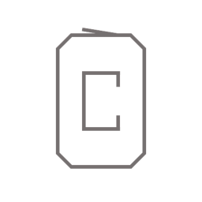

# canned beer sprites

<p align="center">
  
</p>

<p align="center">
  <a href="https://www.python.org/"></a>
  <a href="https://www.microsoft.com/windows"></a>
  <a href="https://www.apple.com/macos/"></a>
  
  <a href="https://doc.qt.io/qtforpython-6/"></a>
  <br>
  <a href="https://doc.qt.io/qtforpython-6/PySide6/QtWidgets/index.html"></a>
  <a href="https://doc.qt.io/qtforpython-6/PySide6/QtGui/QImage.html"></a>
  <a href="https://docs.python.org/3/library/xml.etree.elementtree.html"></a>
  <a href="https://doc.qt.io/qtforpython-6/deployment/deployment-pyside6-deploy.html"></a>
  <a href="https://nuitka.net/"></a>
</p>

Pack your images into a sprite sheet and export the coordinates as XML.
Add your files, choose a layout, preview the result, and click **Generate** to save a transparent PNG and its matching XML file.

No account, server, API key, or Photoshop installation is required.

## Getting Started

### Download and run

Download the build for your computer from [Releases](https://github.com/SquareBracket-GitHub/Canned-Beer-Sprites/releases/latest). Python is included; no development environment or separate runtime installation is required.

<p align="center">
  <a href="https://github.com/SquareBracket-GitHub/Canned-Beer-Sprites/releases/download/v1.1.0/canned-beer-sprites-v1.1.0-windows-x64.exe"></a>
  <a href="https://github.com/SquareBracket-GitHub/Canned-Beer-Sprites/releases/download/v1.1.0/canned-beer-sprites-v1.1.0-macos-arm64.zip"></a>
  <a href="https://github.com/SquareBracket-GitHub/Canned-Beer-Sprites/releases/download/v1.1.0/canned-beer-sprites-v1.1.0-macos-x64.zip"></a>
</p>


> **Windows:** download the exe and run it. No installer is needed.
>
> **macOS:** extract the zip, move **canned beer sprites.app** to Applications, and open it.
>
>> If macOS blocks the first launch, use **System Settings > Privacy & Security > Open Anyway** for this downloaded app. Windows may show an unknown publisher warning because the executable has no publisher certificate.

### Run from source

Use Python 3.10 or newer; Python 3.12 was used for the initial build. Git is needed for the clone command.

```sh
git clone https://github.com/SquareBracket-GitHub/Canned-Beer-Sprites.git
cd Canned-Beer-Sprites
```

**macOS**

```sh
python3 -m venv .venv
source .venv/bin/activate
python -m pip install -e .
python -m canned_beer.app
```

**Windows PowerShell**

```powershell
py -3.12 -m venv .venv
.\.venv\Scripts\python.exe -m pip install -e .
.\.venv\Scripts\python.exe -m canned_beer.app
```

## XML output

```xml
<?xml version='1.0' encoding='utf-8'?>
<TextureAtlas imagePath="spritesheet.png">
  <SubTexture name="idle" x="0" y="0" width="64" height="64" />
  <SubTexture name="idle_2" x="64" y="0" width="64" height="64" />
</TextureAtlas>
```

Each `SubTexture` includes `name`, `x`, `y`, `width`, and `height`. Coordinates are measured in pixels from the sheet's top-left corner, where `(0, 0)` is the origin. Width and height describe the original image bounds and exclude spacing. `imagePath` references the exported PNG filename.

## Contributing

Report bugs or suggest improvements through [GitHub Issues](https://github.com/SquareBracket-GitHub/Canned-Beer-Sprites/issues). Include your operating system, layout settings, image dimensions, and steps to reproduce the problem.

For code changes, fork the repository, create a branch, make a focused change, and open a pull request with a description and verification results.

Run the core tests from the repository root:

```sh
python -m unittest discover -s tests -v
```

These tests cover naming collisions, layout bounds and spacing, oversized inputs, and XML attributes. They do not replace testing the packaged app on each target OS.

## Credit

- **Author:** New Potato
- **GitHub:** [SquareBracket-GitHub](https://github.com/SquareBracket-GitHub)
- **Repository:** [Canned-Beer-Sprites](https://github.com/SquareBracket-GitHub/Canned-Beer-Sprites)